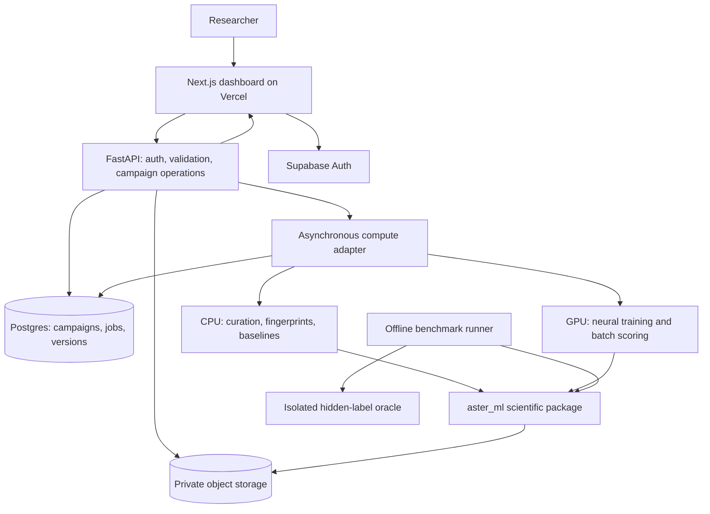

# Aster roadmap

Updated: 2026-10-13. Status: baseline, broader evaluation, and stable-head transfer evaluation completed; bounded encoder fine-tuning pilot completed. Later product integration remains proposed.

### Implementation update — first milestone completed

The original plan below is retained for reference. A Python baseline now runs with
`python -m aster run`; setup and results are in [README.md](README.md).
The landing-page source has been identified separately at `../aster-hero`.
Real ASAP potency curation, Morgan fingerprints, a random forest, five eight-compound
selection rounds, ten paired seeds, audit predictions and a report are implemented.
After QC, the experiment uses 712 published Train compounds and 210 published Test
compounds. Greedy selection recovered 36.0 additional hits on average versus 8.7 for
random selection; random selection had slightly better final audit MAE (0.748 versus
0.793). This is retrospective single-target evidence, not prospective validation.
Eleven tests passed at that milestone. Neural fine-tuning was subsequently completed
in the bounded pilot below; uncertainty-aware selection and dashboard integration remain planned. The report is generated at `artifacts/baseline/REPORT.md`.

### Second milestone — evaluation before added model complexity

Following the “Explain baseline report” discussion, the next implementation is a
broader evaluation followed by frozen CheMeleon comparison. See
[the detailed protocol](docs/BROADER_EVALUATION.md).

- [x] Preserve the original antiviral baseline and artifacts.
- [x] Add three revision-pinned MoleculeACE Ki tasks: CHEMBL1862 for development;
  CHEMBL1871 and CHEMBL2034 for evaluation. Do not treat these related/overlapping
  target datasets as independent evidence across all drug discovery.
- [x] Freeze starting-data sizes of 32 and 64, three paired seeds, and five batches of eight.
- [x] Add published-partition and scaffold-disjoint support/pool/audit protocols.
- [x] Add strongest-decile recovery to avoid the absolute-hit ceiling found on the
  development target. Protocol v2 was fixed before evaluation runs; retain the v1
  development experiment as exploratory history.
- [x] Implement matched Morgan/random-forest, random-selection, Morgan/ridge and
  frozen-CheMeleon/ridge arms, with training-only scaling and no audit tuning.
- [x] Add checkpoint and source checksums, cached embeddings, resumable run contracts,
  explicit coverage, paired differences, per-round records and comparison plots.
- [x] Test split isolation, endpoint conversions, hidden-label independence and
  training-only feature scaling. Verify embeddings against the official method.
- [x] Review all 144 completed replays. On the two evaluation tasks, frozen
  CheMeleon/ridge recovered 11.38 strongest-decile compounds per 40 picks versus
  11.29 for the forest and 12.75 for Morgan/ridge, averaged over matched cases.
  There is no clear overall frozen-model advantage in this small comparison.
- [x] Investigate the unstable frozen head on development data. Training-only
  standardization amplified rare feature variation into extreme audit features
  and predictions. Preserve the original result, including its failures.
- [x] Test stable frozen heads on development data before promoting a neural
  predictor or investing in encoder fine-tuning. See [results](docs/BROADER_RESULTS.md).
- [x] Run a bounded fine-tuning experiment after freezing its development-selected
  settings and defining genuinely additional evaluation tasks for further iteration.

The bounded local encoder fine-tuning pilot is now complete (third milestone below).
Broader adaptation studies, uncertainty-aware acquisition, dashboard integration
and prospective laboratory validation remain later milestones. No paid GPU was used.

### Third milestone — stability, then additional-target transfer

Protocol and reproducible commands: [STABILITY_PROTOCOL.md](docs/STABILITY_PROTOCOL.md).
Configs: `configs/stability-v1.json`, `configs/transfer-v1.json`.

- [x] Predeclare six head recipes and joint stability/discovery gates; run 108
  development replays with both Morgan references and random selection.
- [x] Freeze a training-only feature filter (standard deviation >=0.01), then
  standardization and ridge alpha 10. No prediction clipping. It eliminated
  development guard violations and found 14.83 strongest-decile compounds per
  40 picks, versus 10.33 for the unstable head and 15.17 for Morgan/ridge.
- [x] Evaluate the frozen recipe on three additional targets, two protocols,
  starting sizes 32/64 and two seeds: 96 replays. Exclude structures shared with
  all previously inspected targets, preserving exact source and split manifests.
- [x] Record the negative aggregate transfer result: frozen CheMeleon found
  15.50 strongest-decile compounds per 40 picks versus 17.33 for Morgan/RF and
  18.67 for Morgan/ridge. All predictions stayed inside the broad [0,14] guard;
  sensible-valued predictions do not guarantee useful selection.
- [x] Implement deterministic, observed-only encoder adaptation and pass a
  development runtime check. Fixed five-epoch schedule, local CPU, same final
  ridge policy, fresh foundation initialization each round.
- [x] Complete the predeclared six-case fine-tuning pilot (all three new targets,
  both protocols, 32 initial measurements, seed 0, the same 40-pick budget),
  validate its predictions and compare only matching frozen/Morgan cases.
  Fine-tuned CheMeleon found 13.67 strongest-decile compounds versus frozen 15.33,
  Morgan/RF 16.17 and Morgan/ridge 17.33. It tied frozen in four cases and lost
  in two; audit MAE was nearly unchanged (0.905 versus 0.904). Do not promote
  this adaptation recipe.
- [x] Validate all 210 main replays, pass 28 tests, preserve source snapshots and
  record paired results in [the milestone findings](docs/STABILITY_RESULTS.md).
  Full report: `artifacts/transfer-tuned-v1/REPORT.md`.
- [ ] Add measured reliability beyond gross numerical guards: nearest-measured
  chemical similarity and uncertainty calibration, evaluated for actual failure
  detection under shift. A guard is not a confidence interval.
- [ ] Test a decision policy that responds to unreliability or adds diversity,
  against Morgan/ridge, on newly reserved targets or prospective measurements.

Keep Morgan/ridge as the strongest provisional reference. These additional targets
are project-held-out, not guaranteed absent from foundation-model pretraining or
published model selection. Two of the new targets are kinases. Do not promote a
neural model from development performance or a single small adaptation pilot.
Do not tune further on these inspected evaluation outputs and call them blind.
The next research milestone is reliability-aware selection against Morgan/ridge:
use development data for policy design, reserve additional targets before checking
performance, and test whether uncertainty/diversity changes improve experimental
choices. Build the workflow using the reference model while that research proceeds.

## 1. Product thesis and assumptions

**Aster helps discovery teams choose their next experimental batch by adapting molecular models to small assay datasets and balancing predicted activity, uncertainty, and chemical diversity.**

The first product answers: “We have measured some compounds, have a larger candidate library, and can test only a small batch. What should we test next, and what evidence supports that choice?”

Primary objective: recover useful active compounds under a fixed experimental budget. Improving predictive accuracy is a secondary objective. Active learning optimizes learning; Bayesian optimization seeks good outcomes. Evaluate both, but do not assume one automatically achieves the other.

Planning assumptions:

- One developer initially; public datasets; no existing wet-lab partnership or dedicated GPU assumed.
- Small molecules and one coherent assay endpoint per campaign first.
- A computational research MVP precedes a prospective experimental pilot.
- Initial candidate pools are approximately 1,000–50,000 compounds, subject to measured runtime and memory limits.
- No autonomous purchasing, synthesis, or laboratory execution. A researcher reviews and commits each batch.
- Schedule below is an estimated 10–12 focused engineering weeks; biological validation has a separate timeline.

The deployed [prototype](https://aster-ruby.vercel.app/) was inspected in the browser. It shows 134 untested candidates, 18 assayed compounds, a six-compound round-three proposal, activity/uncertainty plots, molecular descriptors, analog evidence, and budget controls. Those values are illustrative, not training data.

At planning time this local checkout contains an empty README and Git history; the frontend source inspected earlier in this conversation is no longer present. Phase 0 must locate/import the intended landing-page source or scaffold the application. Do not assume existing components are locally available.

## 2. Convert the prototype into a working product

| Prototype surface | Production behavior | Required backend output |
| --- | --- | --- |
| Campaign and round header | Select an assay campaign; inspect previous rounds and dataset versions | Campaign, round, assay definition, model run and snapshot IDs |
| Predict → Prioritize → Test → Learn | Explicit, resumable workflow with running, failed, and completed states | Job status and allowed state transitions |
| Activity-versus-uncertainty candidate map | Plot real predictions; filter measured, untested, excluded and proposed candidates | Mean, uncertainty type, endpoint, candidate eligibility and selection status |
| Compound inspector | Show actual structure, calculated descriptors, nearest measured analogs and source measurements | RDKit structure depiction/descriptors; fingerprint similarity; provenance |
| Ranked shortlist | Explain selection score and diversity contribution; allow exclusions and locked picks | Versioned acquisition configuration, scores, constraints and reason codes |
| Batch-size and priority sliders | Preview an updated proposal from cached predictions | Reproducible selection job; no retraining on every slider change |
| Experimental upload | Preview schema mapping and validation errors before committing results | Import validation report and immutable measurement snapshot |
| Evaluation view | Show learning curves, baseline comparisons, uncertainty calibration and limitations | Versioned benchmark reports |

Important UI changes:

- Label ensemble disagreement as such. “±1σ” is not automatically a calibrated confidence or prediction interval.
- Display pIC50 only for a compatible IC50 regression task. Classification tasks display activity probability; other endpoints retain their correct names and units.
- Keep the prototype’s activity/uncertainty scatterplot. A separate chemical-space view can use a projection, but clustering and diversity decisions must use original features, not 2D plot distances.
- Generate rationale text from recorded facts and reason codes. Similarity and feature attribution are supporting evidence, not a verified mechanism of action.
- Previewing a proposal does not commit a round. Store user overrides and compare the final chosen batch to the original recommendation.
- Show stale-prediction, insufficient-data, invalid-structure, and out-of-domain states explicitly.

MVP workflow: create campaign → upload measurements and candidate structures → validate → train → predict → propose → review and commit batch → export CSV → import assay outcomes → update and repeat.

## 3. Proposed stack and architecture

Keep scientific logic in a reusable Python package that runs identically from the command line, benchmarks, and workers. The web app is an interface to that package.

| Layer | Proposed choice | Purpose |
| --- | --- | --- |
| Web | Next.js App Router, TypeScript, React, Tailwind; Vercel hosting | Reuse the prototype’s visual language and implement campaign workflows |
| Client data | TanStack Query; generated OpenAPI types | Poll asynchronous jobs, cache predictions, keep API contracts explicit |
| Tables/charts | TanStack Table; existing SVG components initially; Canvas when measurements justify it | Inspect compounds and interact with larger candidate pools |
| API | Python 3.11-compatible environment, FastAPI, Pydantic, SQLAlchemy/Alembic | Validation, authorization, campaign mutations and job submission |
| API deployment | One Docker service on a managed container host, initially Render | Keep API requests independent from training jobs |
| Database/auth/storage | Supabase Postgres, Auth and private Storage buckets | Users, campaign metadata, immutable datasets and model artifacts |
| Scientific data | Parquet, PyArrow, NumPy, pandas; RDKit | Efficient tables and chemically meaningful preprocessing |
| Baseline ML | scikit-learn | Fingerprint random forests and simple reference models |
| Neural ML | PyTorch, Chemprop, CheMeleon checkpoint | Train and fine-tune molecular graph models |
| Advanced optimization | BoTorch and GPyTorch, after baseline selection works | Gaussian-process surrogates and probabilistic batch acquisition |
| Cloud compute | Modal CPU/GPU functions behind an adapter | Run bounded, asynchronous training and scoring jobs |
| Reproducibility | uv lockfile, pnpm lockfile, container image digest, Git SHA, JSON run manifests | Rebuild and audit every scientific run |
| Tests | pytest for scientific/API invariants; Playwright for full workflows | Verify the experiment loop and tenant boundaries |

These are proposed choices, not provisioned services. Validate compatible dependency versions in a small training smoke test before pinning them. For Next.js code, read the installed guides under `node_modules/next/dist/docs/` as required by the project instructions.



Job contract:

1. API validates membership and creates a job with an idempotency key and immutable input snapshot.
2. Dispatcher starts external compute and records its execution ID. A reconciliation process retries dispatch failures without duplicating logical jobs.
3. Worker loads only authorized inputs, records progress, and writes artifacts to a run-specific path.
4. Finalization atomically registers artifact hashes and marks the job complete. Retries must not overwrite another run.
5. Dashboard polls persisted status. Failed jobs expose a useful error; training has explicit timeouts, cancellation, concurrency and spending limits.

Do not run long training inside a Vercel request or rely on an in-process API background task for durable jobs. Use a simple local worker adapter before cloud deployment. Start without Redis, Kubernetes, a vector database, or an LLM dependency.

Infrastructure references: [FastAPI deployment](https://fastapi.tiangolo.com/deployment/), [Supabase Auth](https://supabase.com/docs/guides/auth), [Modal invocation methods](https://modal.com/docs/guide/function-invocation-methods), and [Modal compute configuration](https://modal.com/docs/guide/functions). Provider pricing and quotas must be checked when provisioning; this plan does not assume free production hosting.

### Repository layout

```text
apps/web/                 # landing page and campaign dashboard
services/api/             # FastAPI, authorization and persistence
packages/aster_ml/
  data/                   # structures, endpoint normalization, manifests
  features/               # fingerprints and encoder adapters
  models/                 # baselines, neural training and uncertainty
  selection/              # acquisition, diversity and constraints
  evaluation/             # replay loop and metrics
workers/                  # local and cloud execution adapters
configs/                  # immutable experiment configuration templates
benchmarks/               # split manifests and evaluation protocols
tests/                    # focused scientific and integration tests
docs/                     # schemas, model cards and experiment reports
ROADMAP.md
```

## 4. Data model and API boundaries

Core records:

- `workspace`, `membership`, `campaign`: tenant scope, target, endpoint, objective and campaign policy.
- `compound`: original structure, standardized structure, identity key and processing version. Keep supplier IDs and stereochemistry.
- `assay`: target, species, protocol/source, endpoint and available conditions.
- `measurement`: compound, assay, original value/unit/relation, normalized value, replicate, experiment, QC status and provenance.
- `dataset_version`: immutable row membership, schema, file hash, source version and preprocessing configuration.
- `model_run`: dataset version, split manifest, seed, architecture, checkpoint hash, parameters, metrics and artifacts.
- `prediction_set`: model run, candidate snapshot, mean/probability, uncertainty definition, interval method and applicability information.
- `round`, `proposal`, `selection`: batch configuration, model version, ranking, locks/exclusions, selected compounds and researcher overrides.
- `job`, `artifact`: lifecycle state, execution ID, progress and checksums.

Store large feature/prediction arrays in Parquet artifacts; keep searchable metadata in Postgres. Corrections create new dataset versions, preserving prior decisions.

Proposed endpoints: `POST /campaigns`, `POST /imports`, `POST /imports/{id}/commit`, `POST /campaigns/{id}/training-runs`, `POST /campaigns/{id}/prediction-runs`, `POST /campaigns/{id}/proposals`, `POST /proposals/{id}/commit`, `GET /jobs/{id}`, and versioned candidate/measurement/export endpoints. Use `202 Accepted` for long jobs.

The browser never receives cloud service credentials. API verifies tokens and workspace membership; every query and artifact download is tenant-scoped. Supabase RLS is defense in depth, not a substitute for API authorization when service credentials bypass RLS. Use short-lived signed downloads, private buckets, file-size limits and an audit log. Test cross-workspace access before accepting private data. Private campaigns are not pooled for model training by default.

## 5. Datasets: acquisition and intended use

| Dataset | What to use | Role | Key limitation |
| --- | --- | --- | --- |
| [FS-Mol](https://github.com/microsoft/FS-Mol) | Official task lists, task files and split definitions | Few-shot classification/adaptation benchmark | Do not relabel binary tasks as pIC50 regression; preserve its official evaluation track |
| [ASAP–Polaris–OpenADMET](https://huggingface.co/datasets/openadmet/ASAP_Polaris_OpenADMET_challenge) | One coherent potency or ADMET endpoint with published partitions | Campaign demonstration and external evaluation | Audit endpoint completeness and overlap; an unblinded challenge is retrospective when reused |
| [MoleculeACE](https://github.com/molML/MoleculeACE) | Activity-cliff datasets and official evaluation resources | Test whether aggregate accuracy hides failures on close analogs | Audit overlap with other training corpora and molecular pretraining |
| [ChEMBL](https://www.ebi.ac.uk/training/online/courses/chembl-quick-tour/accessing-chembl-data/) | Selected, compatible assay records and metadata | Later multitask pretraining/transfer corpus | Heterogeneous endpoints and protocols require curation |
| [BindingDB](https://www.bindingdb.org/rwd/bind/chemsearch/marvin/Download.jsp) | Target-specific measurements, assay descriptions and dates | Additional target tasks and temporal stress tests | Publication/curation dates are not necessarily experiment dates |
| [PubChem BioAssay](https://pubchem.ncbi.nlm.nih.gov/docs/bioassays) | Clearly documented screening assays with measured inactive outcomes | Later larger hit-discovery pools | Single-concentration screens and confirmatory potency measurements are different tasks |

Initial sequence:

1. Download FS-Mol from its official repository's data link. Freeze source/version/hash and honor task partitions.
2. Inspect the ASAP/OpenADMET schema and choose one sufficiently populated, consistently defined regression endpoint for the UI. Prefer an IC50 task if it satisfies the data audit; otherwise rename the dashboard endpoint correctly.
3. Add a small, predefined MoleculeACE evaluation suite.
4. Only then curate ChEMBL/BindingDB to investigate cross-assay transfer.

Write a manifest for every source: URL, release/revision, retrieval date, checksum, license, permitted usage notes, citation, schema and exclusions. Code, dataset and checkpoint licenses are separate. Dataset selection is not complete until actual eligible counts, missingness, classes, assay compatibility and split overlap are recorded.

### Curation rules

- Preserve raw rows; standardize structures with a versioned policy for salts, charges, tautomers and stereochemistry. Keep raw-to-standardized mappings and report failed/ambiguous cases.
- Use one compatible endpoint per initial campaign. Do not pool IC50, Ki and Kd as interchangeable labels.
- For positive, exact IC50 measurements: `pIC50 = -log10(IC50 in mol/L)`, so `pIC50 = 9 - log10(IC50 in nM)`.
- Preserve inequalities: `IC50 > 10,000 nM` implies `pIC50 < 5`. Start exact-value regression with excluded censored-row counts disclosed; add censored likelihoods later.
- Missing labels are not negative outcomes. Do not expose imputed values as experimental truth.
- Keep replicates and conflicting measurements. Aggregate only with an explicit, assay-compatible policy.
- Group duplicate compound/assay measurements before splitting. Avoid putting duplicate labels in training and evaluation under different database IDs.
- Audit cross-dataset overlap before supervised pretraining. Separately disclose structure-only pretraining overlap and supervised label leakage.

## 6. Model development and fine-tuning recipe

### Models to compare

| Model | Implementation | Why include it |
| --- | --- | --- |
| Fingerprint baseline | RDKit Morgan fingerprints, radius 2, 2,048 bits as an initial configuration; random forest | Strong inexpensive reference |
| Graph model from scratch | Chemprop D-MPNN | Separates architectural value from pretraining |
| Frozen pretrained model | CheMeleon encoder + regularized linear or small neural head | Tests representation quality with little adaptation |
| Fine-tuned graph model | CheMeleon initialized Chemprop | Primary deep-learning candidate |
| Probabilistic alternative | Frozen neural embeddings with a Gaussian process | Research track for low-data selection |
| 3D alternative | Uni-Mol | Later ablation when conformer processing and compute are justified |

Resources: [RDKit](https://github.com/rdkit/rdkit), [Chemprop](https://github.com/chemprop/chemprop), [CheMeleon](https://github.com/chrissly31415/chemeleon), [Uni-Mol](https://github.com/deepmodeling/Uni-Mol), [Molfeat](https://github.com/datamol-io/molfeat), [ADKF-IFT](https://github.com/Wenlin-Chen/ADKF-IFT).

Chemprop supplies the trainable graph model; CheMeleon supplies pretrained weights. Start with its documented `finetuning_demo.ipynb` and `--from-foundation CheMeleon` workflow, verifying the exact syntax against the pinned release. Do not assume a library install alone supplies a model adapted to the campaign.

### Fine-tuning procedure

1. Freeze task splits before fitting anything. Use development tasks for hyperparameter decisions. Only acquired labels from a campaign may enter its adaptation routine.
2. Compute and cache standardized structures, fingerprints and frozen embeddings. Fit target scaling on training data only; invert it for displayed regression predictions.
3. Train a frozen-encoder head as the first adaptation baseline. For classification use binary cross-entropy; for exact regression begin with MSE. Apply missing-label masks for multitask data.
4. Fine-tune the encoder with a lower learning rate than the new head. Initial search ranges: encoder `1e-5`–`1e-4`, head `1e-4`–`1e-3`, weight decay `1e-6`–`1e-3`, batch size 32 or 64, maximum 100 epochs and patience 10. These are proposed starting ranges, not validated optimal settings; supported parameter groups depend on the implementation.
5. Select hyperparameters using development tasks and visible training-label validation only. For very small campaigns, prefer a preselected schedule over an unstable tiny holdout. Never early-stop on hidden candidate labels or final audit labels.
6. Train three independently seeded members for development and consider five for final comparisons if compute permits. Compare ensemble mean and disagreement; measure calibration rather than declaring disagreement a posterior standard deviation.
7. Freeze all choices before final evaluation. Log checkpoint hash, data snapshot, split IDs, target transformation, seed, code revision, training history and runtime.
8. On a new assay round, start from the same foundation checkpoint with all currently acquired labels for the cleanest first benchmark. Treat warm-starting from the previous round as a separate, explicitly compared optimization.

Freeze-first versus full fine-tuning is an empirical choice. Small datasets can favor the frozen model or random forest. Keep the best supported model for the campaign instead of forcing a neural model into every task.

For a Gaussian-process model, use standardized or dimension-reduced frozen embeddings with a small-data GP first; fit any learned reduction on permitted training features. Document kernel and noise assumptions. A neural ensemble cannot be dropped into GP-specific BoTorch acquisition code without a compatible posterior adapter.

### Uncertainty and calibration

- Baseline: report ensemble disagreement, nearest-neighbor similarity and validation errors separately.
- Later: test heteroscedastic predictive heads and held-out interval calibration. Replicate data are needed to validate claims about experimental noise.
- Track interval coverage and width, classification Brier score/reliability, and errors by novelty/scaffold group.
- Standard conformal coverage assumptions can fail under adaptive selection or distribution shift. Do not promise distribution-free coverage on every future campaign. If calibration measurements consume real assay budget, count them.
- At low sample sizes, show insufficient calibration evidence rather than precise-looking unsupported intervals.

## 7. Batch selection and proposed innovation

### Implement a transparent baseline first

For regression on a common scale, begin with a heuristic upper-confidence score:

`score(x) = predicted_mean(x) + beta * ensemble_disagreement(x)`

Then select greedily with a fingerprint-similarity penalty, excluding already measured/pending compounds and honoring researcher locks. Record the formula, beta, diversity strength, tie-breaking seed and candidate snapshot. This is an ensemble-based heuristic, not a theorem-backed confidence bound.

Compare against random, diversity-only, nearest-active-analog and greedy-mean selection. For classification use activity probability and a task-appropriate exploration score. Document the priority-slider mapping; tune defaults only on development data.

Next, compare GP-based batch acquisition in [BoTorch](https://github.com/meta-pytorch/botorch), including noisy expected improvement where appropriate. Benchmark [BayBE](https://github.com/emdgroup/baybe) as an existing experimental-planning alternative. Do not simultaneously maintain two optimization engines without an experimental reason.

Begin with number of assays as the budget. Add monetary cost, availability and turnaround only when real metadata exist. A cost-aware optimizer should respect total batch cost; dividing scores by price alone does not solve every constrained batch problem.

### Prioritized research hypotheses

| Priority | Hypothesis | Proposed experiment | Evidence needed to retain it |
| --- | --- | --- | --- |
| First | Pretrained adaptation plus uncertainty/diversity selection finds useful compounds with fewer measurements | Factorial comparison of model family and acquisition strategy | Gains across held-out tasks and paired seeds, not one attractive curve |
| Second | Assay context improves transfer to a new assay | Molecular encoder plus context embedding/hierarchical assay head; missing-context mask; held-out-assay evaluation | Improvement over molecule-only and assay-specific baselines without target leakage |
| Third | Activity-cliff-aware pair modeling improves selection around close analogs | Auxiliary pairwise potency-difference loss within training partitions; acquisition ablation | Better cliff-region discovery/error without unacceptable overall regression |
| Later | Repeat/confirm decisions can outperform always testing a new compound | Optimize over compound × measurement type using replicate/noise information | Matched replicate data or explicitly labeled simulations; eventual prospective confirmation |

These are research directions, not established novel inventions. Review related work before making novelty claims. Assay-ID embeddings alone cannot represent an unseen assay usefully; require transferable metadata or adaptation from a support set. Auxiliary pairs must be generated after splitting to avoid leakage.

A practical differentiator could be transparent handling of assay mismatch, honest uncertainty, and reproducible batch decisions in a narrowly validated setting. Existing software already offers prediction and active learning: inspect [Cerella](https://optibrium.com/products/cerella/), [Deepmirror](https://www.deepmirror.ai/post/finding-new-active-molecules-6x-faster-with-deepmirror), and [Schrödinger's discovery workflows](https://www.schrodinger.com/life-science/solutions/hit-to-lead-and-lead-optimization/). Their descriptions are vendor claims, not independent performance comparisons.

## 8. Evaluation protocol and release gates

Keep two tracks: official dataset prediction benchmarks for comparability, and a separately documented Aster campaign replay protocol. Custom selection experiments must not be reported as official benchmark scores.

1. Separate development tasks from final evaluation tasks. Document scaffold-group, assay and temporal splits; run these as distinct stress tests where valid metadata exist.
2. Within each replay task, define initial observed labels, an eligible acquisition pool, and an untouched audit set. Final-task adaptation uses only permitted support/acquired labels.
3. Start with a feasible support size such as 32; expand to 64 and 128 where task size permits. Specify minimum remaining pool size, class support and exclusions before running.
4. Initially acquire batches of eight for five rounds. Count every measurement used for adaptation or calibration in the experimental budget.
5. Keep acquisition-pool labels behind a separate oracle interface that only returns requested selections. Keep audit labels inaccessible to training and selection. Ideally run the oracle in a separate process without mounting its files into workers.
6. Refit/update, score remaining candidates and repeat. Use matched initial samples and seeds for competing strategies; start with ten paired seeds for the final suite, subject to a declared compute budget.
7. Report per-task outcomes and aggregate paired differences with intervals that account for tasks and repeated seeds. Do not treat correlated rounds as independent experiments.

Primary metric: additional hits recovered at a fixed acquisition budget, using a prospectively specified task threshold. Secondary metrics: area under the hit-discovery curve, best observed potency, active scaffold coverage, classification PR-AUC or regression MAE/RMSE on the audit set, calibration, wall-clock runtime and actual compute cost.

For assays without an accepted activity threshold, declare a benchmark convention before final evaluation and avoid presenting it as a biological validation criterion. Do not choose thresholds from the final outcomes to favor the method.

Minimum evidence gates:

- Data pipeline: identity, units, censoring and duplicate handling validated; split leakage checks pass.
- Research: compare against random and a strong fingerprint baseline, not just a weak neural baseline.
- Promotion: predeclare a practically meaningful gain with a lab/domain reviewer; require consistent evidence across tasks and disclose uncertainty. An inconclusive result leads to iteration, not a performance claim.
- Product: upload → train → propose → export → import → next round works reproducibly, including job failure/retry.
- Prospective claim: requires new laboratory measurements obtained after recommendations were frozen.

Retrospective pools contain compounds someone previously chose to measure; they are selected samples of chemistry. Replay success does not establish performance over arbitrary vendor libraries or successful drug discovery.

## 9. Implementation milestones

| Phase | Estimated time | Deliverables | Exit criterion |
| --- | --- | --- | --- |
| 0. Scope and repository | Week 1 | Locate prototype source; choose first endpoint; dependency smoke test; dataset/license manifests; user workflow interviews | A reproducible small real dataset and agreed campaign definition |
| 1. Scientific foundation | Weeks 2–3 | Curation package, fingerprints, RF baseline, split manifests, isolated replay oracle | Reproducible baseline report with leakage checks |
| 2. Neural adaptation | Weeks 4–5 | Scratch Chemprop, frozen CheMeleon, fine-tuning, ensemble outputs | Fair comparison with identical data/budgets and saved artifacts |
| 3. Experimental selection | Weeks 6–7 | Random/diverse/greedy/uncertainty policies; constraints; replay metrics | Auditable selection curves and a documented default strategy |
| 4. Product integration | Weeks 8–9 | API, auth/storage, async jobs, dashboard, inspector, imports and exports | Complete two-round workflow using real public measurements |
| 5. Research and pilot readiness | Weeks 10–12 | One research ablation, final held-out evaluation, model cards, lab feedback | Honest evidence report, reliable jobs and defined pilot protocol |

The schedule assumes focused work and dataset availability. A negative model result does not block building the workflow with a baseline. A prospective lab pilot starts only after a partner, assay, budget and protocol are available.

### First ten implementation tasks

- [ ] Locate/import the intended frontend source and read its installed Next.js documentation.
- [x] Select an assay and create a versioned dataset manifest.
- [ ] Define molecule, assay, measurement, snapshot and model-run schemas.
- [ ] Implement CSV validation, structure standardization and correct endpoint normalization.
- [x] Create duplicate-aware splits and hidden-label replay interfaces.
- [x] Train the fingerprint baseline and reproduce its metrics from a saved configuration.
- [x] Add frozen CheMeleon embeddings and a small prediction head.
- [x] Run one controlled fine-tuning comparison.
- [ ] Implement batch selection with exclusions, locks and diversity.
- [ ] Feed real saved predictions into the prototype map, inspector and shortlist.

## 10. Papers and open-source study plan

| Read | Why it matters | Concrete output |
| --- | --- | --- |
| [Traversing chemical space with active deep learning for low-data drug discovery](https://www.nature.com/articles/s43588-024-00697-2) | Molecular active-learning behavior | Baseline policies and low-data experiment design |
| [FS-Mol: A Few-Shot Learning Dataset of Molecules](https://openreview.net/pdf?id=701FtuyLlAd) | Task-level adaptation evaluation | Official task/split loader and comparable classification evaluation |
| [Descriptor-based Foundation Models for Molecular Property Prediction](https://arxiv.org/abs/2506.15792) | CheMeleon pretraining and transfer | Frozen versus fine-tuned adaptation experiment |
| [Chemprop: A Machine Learning Package for Chemical Property Prediction](https://pmc.ncbi.nlm.nih.gov/articles/PMC10777403/) | Molecular graph prediction implementation | A reproducible supervised graph baseline; consult current v2 docs for APIs |
| [Meta-learning Adaptive Deep Kernel Gaussian Processes for Molecular Property Prediction: paper/code](https://github.com/Wenlin-Chen/ADKF-IFT) | Low-data probabilistic modeling | Optional embedding-plus-GP ablation |
| [BoTorch: A Framework for Efficient Monte-Carlo Bayesian Optimization](https://arxiv.org/abs/1910.06403) | Probabilistic acquisition | GP acquisition comparison after simple selection works |
| [Exposing the Limitations of Molecular Machine Learning with Activity Cliffs](https://pure.tue.nl/ws/portalfiles/portal/257498223/acs.jcim.2c01073.pdf) | Failure cases on similar compounds | Cliff-specific metrics and later pairwise modeling |
| [Conformal Validity Guarantees Exist for Any Data Distribution (and How to Find Them)](https://proceedings.mlr.press/v235/prinster24a.html) | Sequential selection changes uncertainty assumptions | A calibration protocol with clearly stated assumptions |

Reuse chemistry tooling, model implementations, and optimization libraries. Build Aster's data contracts, experiment lifecycle, evaluation harness, decision provenance, and selected research extensions.

## 11. Adjacent research options

Choose at most one after the molecular MVP has a credible benchmark result or a lab partnership points to a better problem.

| Direction | Resources | Technical opportunity | Added burden |
| --- | --- | --- | --- |
| Cellular phenotype selection | [JUMP Cell Painting paper and data](https://www.nature.com/articles/s41592-024-02241-6) | Fuse molecular and image representations to choose phenotypic experiments | Batch effects, image compute and distinguishing measured candidate profiles from unavailable future measurements |
| Protein engineering | [ProteinGym](https://github.com/OATML-Markslab/ProteinGym) | Adapt protein representations and select variants for fitness measurements | Protein-specific representations and carefully grouped variant splits |
| Genetic perturbations | [GEARS](https://github.com/snap-stanford/GEARS) | Select informative perturbations and predict expression responses | Combinatorial generalization, biological confounding and demanding baselines |
| Reaction/formulation optimization | [BayBE](https://github.com/emdgroup/baybe) | Transfer learning and cost-aware decisions in mixed parameter spaces | A different dataset schema and experimental customer workflow |

For multimodal experiments, do not feed the measured outcome of an unperformed experiment into its own selection model. Use only features available at decision time, or explicitly charge for measuring them.

## 12. Compute, partnerships and remaining decisions

Start curation, fingerprints and baselines locally on CPU. Use one on-demand GPU for initial neural experiments, with a small smoke run to measure memory and throughput. A 16–24 GB GPU is a starting sizing hypothesis for the small-model track, not a requirement or guarantee. Benchmark before reserving resources; defer large 3D models and pretraining from scratch.

Budget formula: number of tasks × seeds × rounds × ensemble members × measured training time, plus inference, storage and service costs. Cache deterministic features, cap search trials, shut down idle compute, and get a spending limit before provisioned runs. No training or paid provisioning is performed by this roadmap.

Find a medicinal/computational chemist to review endpoint curation and a lab willing to share a de-identified campaign or run a small prospective batch. Interview researchers about existing selection practice, assay failure rates, data exports, budget constraints and what recommendation evidence they trust. The most valuable pilot is a repeatable comparison against their actual decision process.

Decisions to confirm before the relevant phase:

1. Is the near-term goal a research portfolio/paper, a lab pilot, or commercial SaaS? Default: research MVP that can support a lab pilot.
2. Is a particular target, assay, or collaborator available? Default: choose by public-data quality, then narrow with a partner.
3. What GPU/cloud spending cap and weekly time budget apply? Default: local baseline work first; no paid run assumed.
4. Where is the landing-page source that should be reused? The current checkout does not include it.
5. Will private laboratory data enter the first release? Default: public data only until access controls and data-use agreements are ready.

First complete deliverable: a reproducible public-data campaign with real model predictions, documented fine-tuning, an auditable recommended batch, and a second round that learns from revealed measurements. Its evaluation should explain where Aster helps, where it does not, and what remains unvalidated.
