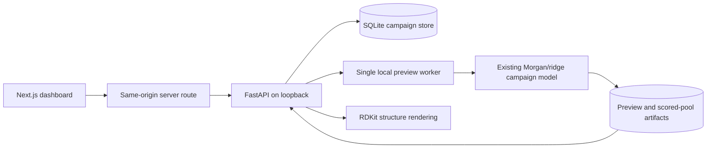

# Connected local dashboard

The workspace app lives at `apps/web/`. `/` redirects to `/dashboard`, the
connected campaign workspace. The landing page lives exclusively in the separate
`../aster-hero` repository and site; no marketing page or illustrative demo is
served by this app.

## Folder map

```text
aster/                 Python package: chemistry, models, selection, campaigns, API
apps/web/              Next.js frontend: campaign workspace and molecular evidence
examples/dashboard/    Small public-data CSV fixture and replay outcomes
scripts/               Launchers, demonstrations and verification scripts
tests/                 Scientific, campaign and API tests
artifacts/dashboard/   Local databases, model previews and job state (gitignored)
```

The outer `aster` directory is the repository. Its inner `aster/` directory is an
importable Python package: `python -m aster.campaign` runs that package's campaign
module. It is not another application or the frontend.

## Start locally

From the repository root, using the existing Python 3.12 environment:

```sh
.venv/bin/python -m pip install -e '.[web]'
npm --prefix apps/web ci
.venv/bin/python scripts/dev_dashboard.py
```

Open http://127.0.0.1:3000/dashboard. The API's generated OpenAPI documentation is
at http://127.0.0.1:8000/docs. Ctrl-C in the launcher stops both services.
`requirements-dashboard.lock.txt` captures the complete tested environment,
including prior neural dependencies; the `web` extra is sufficient to add the API
to the baseline environment. Frontend dependencies are pinned by its package lock.

For a fresh environment, create `.venv` with Python 3.12 first, then run the commands
above. Install `.[dev,web]` as well when running tests. Neural tests additionally
need the neural extra or the captured complete dependency lock.

To verify/run a production build instead:

```sh
npm --prefix apps/web run build
# Terminal 1
.venv/bin/python -m uvicorn aster.api:app --host 127.0.0.1 --port 8000
# Terminal 2
npm --prefix apps/web run start -- --hostname 127.0.0.1 --port 3000
```

`ASTER_STORAGE` changes the API's local artifact directory; `ASTER_API_URL` changes
the Next.js server-side API destination (default `http://127.0.0.1:8000`). Use one
API process/worker. This prototype is local and unauthenticated; it has not been
published to the existing Vercel deployment. A public/shared backend requires a
separate deployment and access-control step.

## What works

- Create a campaign from two CSV files, with validation errors displayed in the form.
- Start a public-data replay from 32 measured compounds and 128 untested candidates.
- Preview a batch without changing measurements or committing a round.
- Plot real predictions against similarity to the nearest measured compound.
- Inspect an RDKit-rendered molecular structure, predicted endpoint, nearest measured
  analog, analog measurement, and selection reason. No synthetic confidence interval.
- Lock or exclude available compounds; a changed campaign invalidates old previews.
- Explicitly commit a reviewed batch. Retries of the same preview commit are idempotent.
- Download the committed batch or an empty result template.
- Upload partial/exact measurements or failed-assay outcomes; conflicting edits are rejected.
- Refit the next round, switch campaigns, filter/search the library and inspect prior rounds.
- Reload the browser and retain saved campaigns, committed rounds and results.

On reload, the historical view displays committed-batch predictions. Full scored
candidate pools remain in the corresponding preview artifact. Generate a new
preview for the current eligible pool. Historical predictions are never replaced
by a model refitted on subsequently revealed results.

The public replay button explicitly imports previously measured outcomes only for
a committed batch. It is disabled by absence for ordinary CSV-imported campaigns.
The fixture is a workflow demonstration, not new evaluation evidence or a claim
about laboratory performance. Import formats and chemistry policies are documented
in [CAMPAIGN_WORKFLOW.md](CAMPAIGN_WORKFLOW.md).

## Architecture and recovery



Preview jobs have persisted queued/running/complete/failed states. The local worker
runs one model job at a time. A restart marks interrupted work failed so it can be
retried; this is restart-aware local execution, not a distributed durable queue.
The client can reconnect to its pending job after reload. No cloud compute is used.

A preview captures the full campaign revision. Commit checks that revision within
a SQLite write transaction, prevents stale acceptance, and records the preview ID
with the immutable model/training/recommendation snapshot. Committing the same ID
again returns the existing round. Constraint edits also compare revisions.

Next.js proxies requests on the same origin; the Python API is bound to loopback.
CSV inputs are capped at 2 MB per file and 2,000 rows per file for this bounded
prototype. These caps are implementation limits, not a large-library benchmark.
The campaign store and preview files contain full molecular data and should be
preserved together. Research benchmark artifact directories are unchanged.

## Verification

```sh
MPLCONFIGDIR=.mplconfig .venv/bin/python -m pytest -q
npm --prefix apps/web run build
# With both servers running and agent-browser installed:
sh scripts/verify_dashboard.sh
```

Verified on the local production build:

- **54 Python tests pass**, including five API tests covering the two-round loop,
  stale/cross-campaign previews, result conflicts, local-origin handling and restart recovery.
- Production build and TypeScript checks pass.
- Browser public replay completes two batches, reaches 48 measured compounds,
  retains both rounds on reload, and opens the workspace from the root URL.
- Real CSV campaign upload succeeds and creates an ordinary campaign; uploading
  its committed-batch result CSV completes the round and updates measurements to 40.
- Desktop and 390px mobile screenshots inspected; no horizontal page overflow.

The browser verifier uses an isolated session and activates existing DOM controls.
Screenshots are written to `artifacts/dashboard-verification/`. One upstream
Starlette test-client deprecation warning is currently emitted; tests still pass.

## Next milestone

The local 3D structural-evidence inspector and exploratory docking are implemented;
see [MOLECULAR_REPLAY.md](MOLECULAR_REPLAY.md) and [DOCKING.md](DOCKING.md).
Independent docking transfer validation, literature RAG, calibrated confidence,
and public deployment remain future work in [PRODUCT_EXTENSIONS.md](PRODUCT_EXTENSIONS.md).

## Prototype design integration

The live workspace places the candidate map and compound inspector side by side, with the ranked batch spanning the width below. It retains `WorkflowSteps`, the Aster wordmark/mark, keyboard hints, global ink/paper/violet tokens, and locally bundled Geist Sans/Mono typefaces. The shortlist supports Up/Down keyboard selection and exposes its selected state to assistive technology.

Live evidence remains distinct from illustrative hero data: the dashboard displays actual ridge predictions, measured analogs, and Tanimoto similarity. It does not render the hero's illustrative uncertainty intervals as model outputs.

Design verification: production build and TypeScript passed; desktop and 390px mobile layouts were inspected; two public replay rounds preserved 32 → 40 → 48 measurements after reload. The root URL redirects to the workspace; the landing page is maintained separately.

### Adjustable panels

The live dashboard has no traffic-light window controls. Its campaign header, open shortlist rows, outlined proposed markers, larger structure card, and aligned evidence rows follow the hero prototype.

On desktop, drag the vertical divider to change the landscape/inspector width ratio. Drag the divider below those panels to adjust their shared height, or the divider below the batch to change the table's scrollable height. Focus a divider and use arrow keys for keyboard resizing; Home/End select its bounds. Double-click resets one divider, and **Reset layout** restores all dimensions. Sizes persist locally across reloads. Mobile uses stacked, naturally sized panels.

Verified with a real pointer drag, keyboard height adjustments, persisted dimensions after reload, reset, a live 128-candidate/eight-pick preview, and a 390px mobile overflow check. Production build and TypeScript passed.

The selected-compound inspector now includes **Explore 3D docking**. It opens the selected campaign/compound in the molecular workspace, where users can request and revisit persisted docking jobs. Only the verified DAT demo is enabled. See [DOCKING.md](DOCKING.md) for validation results, controls, limitations and setup.

## Workspace separation check (2026-10-14)

The marketing components, illustrative data, and landing-page navigation were
removed from this repository. The root route redirects to `/dashboard`.
All 60 Python tests pass. The production build and TypeScript check pass with
`npm --prefix apps/web run build -- --webpack`; the default Turbopack build
encountered a local build-worker port permission error in this environment.
The generated root page was checked for its dashboard redirect. Browser workflow
checks above describe prior feature verification and were not rerun for this removal.
