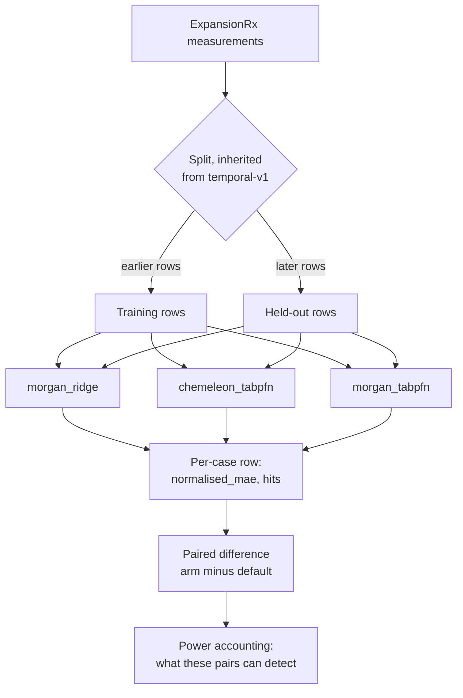

# The two-model bracket

Queue item 11. This document is the protocol and the state of the evidence, in
that order. It is written for a reader who is not an ML specialist, so each term
is defined where it first appears.

## What this is for

Every number Aster reports comes from one model family: **Morgan fingerprints**
(a long row of yes/no flags recording which small substructures a molecule
contains) fed into **ridge regression** (a straight-line fit with a penalty that
keeps the coefficients small so a short dataset cannot push them around). That
family has never been given a rival on the project's own splits, so none of the
project's results can say whether the family is what limits the predictions or
whether the data is.

A **bracket** runs a second family beside the default on the identical splits and
records both. Neither replaces the other. The default stays the default: swapping
it would be a product decision with its own record, not an outcome of this file.

## The arms

| Arm | Features | Head | Why it is here |
| --- | --- | --- | --- |
| `morgan_ridge` | Morgan fingerprint, 2048 bits, radius 2 | ridge | The product default, run through the existing code in `aster/temporal.py` so it is the same arm as in `docs/TEMPORAL_RESULTS.md`. |
| `chemeleon_tabpfn` | frozen CheMeleon embeddings | TabPFN | The arm the queue item declares: a second family over pretrained features. |
| `morgan_tabpfn` | the default's own fingerprints | TabPFN | Separates "the head helped" from "the representation helped". Without it, a win by the arm above cannot be attributed. |

**CheMeleon** is a molecular encoder already pinned in this repository: a network
trained on a large corpus of molecules that turns a structure into a fixed row of
numbers (an *embedding*). It is used frozen, meaning its weights never change and
no assay label reaches it.

**TabPFN** is a transformer pretrained on millions of synthetic tables. It is
given the training rows and the rows to predict in one go and answers in a single
forward pass, with no gradient training on the assay data at all. That is why it
is interesting for Aster: the datasets here are a few hundred to a few thousand
measurements, the regime it was built for.

## Protocol

- Splits, endpoints, transforms, minimum sizes and the batch criteria are
  **inherited** from `configs/temporal-v1.json`; `configs/bracket-v1.json` adds
  only the arms and the seeds. The bracket therefore reports on the same
  time-ordered holdout as the existing temporal study, and its numbers sit beside
  those rather than beside a second, slightly different protocol. Both config
  checksums are recorded in the output.
- Per endpoint: the one deterministic temporal split, plus five matched random
  splits at the same training and test sizes. Every arm sees the identical rows,
  so an arm is only ever compared with the default on the same case.
- Two metrics per case. `normalised_mae` is the average error divided by the
  spread of the held-out values, so 1.0 means "no better than quoting the
  average". `hits` is how many of a 40-compound batch meet the endpoint's
  declared criterion, which is the number the milestones actually report.
- TabPFN cannot read 2048 columns; it is built for tables of at most a few
  hundred. Each TabPFN arm therefore keeps the 200 columns that **vary most
  across the training rows**. That choice reads the training feature matrix only:
  no measured value and no held-out row enters it, which
  `tests/test_model_bracket.py` checks directly.
- Paired analysis only, through `aster/evidence_power.py`, as the item asks. Each
  arm's difference from the default is taken case by case, and every reported
  mean comes with the smallest difference those pairs could have detected. A
  mean near zero is never written up as the two families being equal.



## Weights are not downloaded

Neither pretrained checkpoint is fetched by this code. Both are loaded from a
local path whose SHA-256 is pinned in the config, the way
`aster/representations.py` already loads CheMeleon, so a run either uses the exact
weights the record names or stops. An arm whose weights are absent is written
into the metrics file as `unavailable` with the reason, and the analysis lists it
under `arms_that_did_not_run`, so a missing arm can never quietly disappear from
a comparison.

The TabPFN checksum in `configs/bracket-v1.json` is deliberately the placeholder
`UNVERIFIED-SET-BEFORE-FIRST-RUN`, and a test asserts it still is. Prior Labs
distribute TabPFN's weights through Hugging Face under their own licence, and
recent releases of the package require a one-time licence acceptance and an API
token before they will download anything. That is an operator's decision, not a
build run's.

## State of the evidence

**The comparison has not been run.** The nightly build machine cannot reach the
host that serves either checkpoint: Hugging Face redirects large files to
`us.aws.cdn.hf.co`, which this environment's network policy refuses, and the
current TabPFN package additionally asks for a licence token. So this is a
harness plus a priced design, not a result.

What did run, on the real release, with the default arm and both TabPFN arms
declared:

```
$ python -m aster.model_bracket
logd: 18 rows so far
...
mgmb: 162 rows so far
arms_that_did_not_run:
  chemeleon_tabpfn: CheMeleon checkpoint not present at data/models/chemeleon_mp.pt
  morgan_tabpfn:    TabPFN checkpoint not present at data/models/tabpfn-v2-regressor.ckpt
```

162 rows: 9 endpoints x 6 splits x 3 arms. 54 of them scored, the default arm's.
The default arm reproduces the known temporal penalty, which is the check that
the bracket is running the same protocol as the existing study:

| Split | mean `normalised_mae` | mean `hits` per 40 | expected `hits` if picked at random |
| --- | --- | --- | --- |
| temporal | 1.018 | 25.1 | 19.0 |
| random_matched | 0.592 | 32.1 | 19.3 |

### What this size of bracket could and could not settle

Priced from the case-to-case spread of the default arm, as an upper bound (two
arms on the same split move together, so their paired differences are usually
less spread out than the metric itself):

| Metric | Cases | Smallest difference detectable at 80% power | Cases needed for a difference of 1.0 |
| --- | --- | --- | --- |
| `normalised_mae` | 54 | 0.10 | 3 |
| `hits` per 40-compound batch | 54 | 2.96 | 468 |

This is the finding worth carrying forward, and it is a negative one. On
accuracy, 54 cases are ample: a tenth of a normalised error unit is a difference
anyone would act on, and the design can see it. On the metric that decides
whether a model family is worth adopting -- how many useful compounds a batch of
40 contains -- the same design can only see a difference of about three
compounds. To resolve one extra compound per batch would take roughly 468 cases,
about nine times this bracket. Running the bracket as declared can therefore
conclude "TabPFN predicts more accurately" while being unable to say whether that
buys a single better pick. Any claim in the second direction needs more
endpoints, more seeds, or a sequential design, declared before the run.

## Running it once the weights are in place

```
# 1. Obtain the checkpoints yourself and put them where the config points:
#      data/models/tabpfn-v2-regressor.ckpt
#      data/models/chemeleon_mp.pt
# 2. Record what you actually downloaded:
sha256sum data/models/tabpfn-v2-regressor.ckpt
#    then replace UNVERIFIED-SET-BEFORE-FIRST-RUN in configs/bracket-v1.json
#    and delete tests/test_model_bracket.py::test_the_configured_tabpfn_checksum_is_still_a_placeholder
# 3. Install the extras and run:
pip install -e '.[tabpfn,neural]'
python -m aster.expansionrx                     # if measurements.csv is not present
python -m aster.model_bracket --arms morgan_tabpfn chemeleon_tabpfn
```

Expect this to be slow on a laptop CPU: TabPFN is refitted per case, 54 cases per
arm. The `--arms` flag takes a subset, so the cheaper `morgan_tabpfn` arm can be
run first as a smoke test; the default arm is always included because it is the
comparison.
