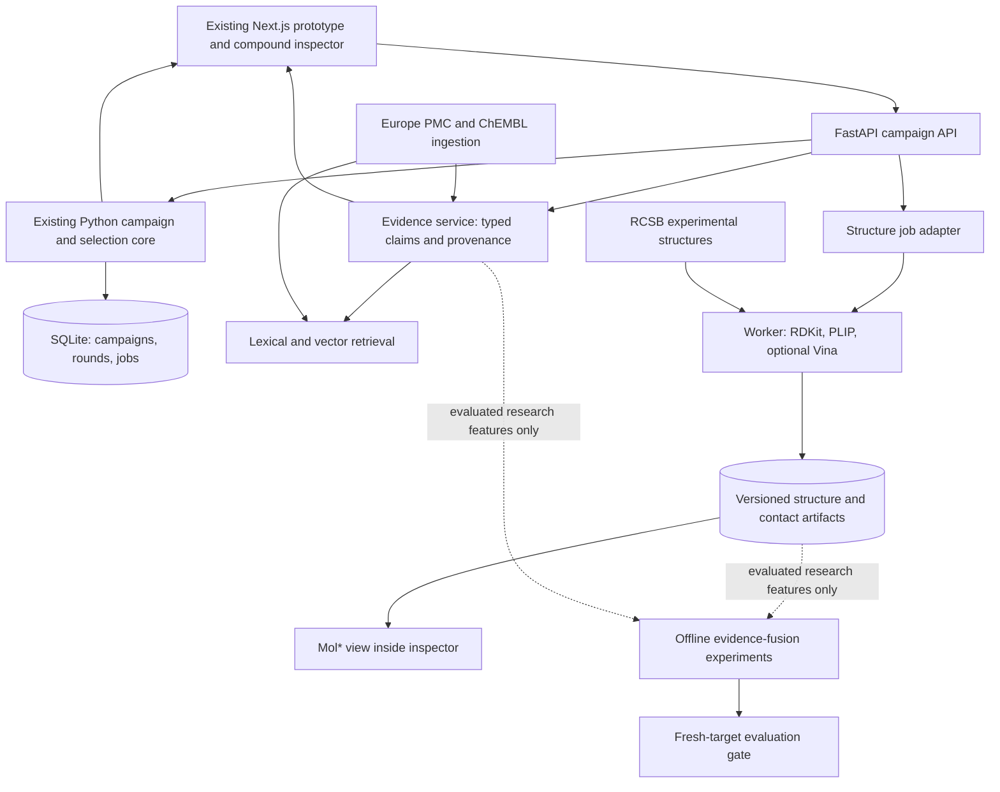

# Aster: dashboard integration, 3D evidence, and literature-assisted selection

Planning update: 2026-10-13. Milestone 6 is now implemented locally in `apps/web/`
and `aster/api.py`; see [DASHBOARD.md](DASHBOARD.md). The structural and literature
extensions remain proposals. The scientific core is `aster/campaign.py`.

## 1. Reuse the existing prototype

The frontend exists at `../aster-hero`. Inspection confirmed Next.js/React/TypeScript,
Tailwind, `src/components/ProductPreview.tsx`, `CandidateMap.tsx`, `Molecule.tsx`,
and an inspector. `src/lib/data.ts` explicitly supplies synthetic compounds,
predictions, uncertainties, rationales, and assay values. The prototype is a useful
visual shell, not yet a frontend to the campaign database.

Integrate that design with the campaign backend. Keep the public landing preview
as an explicitly illustrative mode and add a working campaign route using the same
components. A recorded public-data snapshot can support a hosted demonstration;
label it read-only. A live local prototype supports imports and the full two-round
loop. Neither requires accounts, billing, or an enterprise deployment first.

Changes needed before real data replace fixtures:

- Use the campaign's actual endpoint, counts, round, structures, and batch size
  (default eight), instead of fixed pIC50, six picks, or illustrative values.
- Replace `sigma`, confidence intervals, and Explore/Balanced role labels with
  supported fields. Default plot: predicted endpoint versus nearest-measured
  similarity or novelty, explicitly labelled. Novelty is not confidence.
- Show real nearest observed analogs, measured values, and user overrides.
- Generate selection explanations from saved records. The present model does not
  estimate that a pick will reduce uncertainty throughout a chemical region.
- Expose empty, invalid-input, pending, failed, and completed states.
- Split proposal preview from commitment. The current CLI `propose` immediately
  commits a batch; it must not be called whenever a slider or filter changes.
- Add round-specific scoring for all eligible candidates. Current snapshots store
  selected predictions and a fitted model, not a complete scored-pool table.

### Milestone 6 — live prototype integration

**Stack:** existing frontend; FastAPI/Pydantic over the Python campaign package;
SQLite and local artifacts; one local worker process with persisted job status.
Reuse current dependencies and lockfiles. A local development proxy connects the
frontend to the API. Do not expose the unauthenticated local API publicly.

**Proposed endpoints:** create/validate campaign; campaign status; paginated scored
candidates; compound evidence; preview batch; commit preview; export batch; validate
and import results; job status. Generate frontend types from OpenAPI. Add campaign
revision and training-snapshot hashes to previews; reject stale commits. Preserve
original recommendations separately from researcher overrides.

**Exit gate:** browser test imports public data, previews and commits eight picks,
exports them, imports measured/failed outcomes, and reaches round two. Reloads and
request retries preserve state. Browser predictions match saved backend outputs.
No fabricated uncertainty, stale fixture rationale, or mixed endpoint labels.

## 2. Has this already been done?

Yes: Aster's ingredients, and several combinations of them, already exist. This is
not a claim that Aster has invented molecular active learning, binding visualization,
or scientific retrieval. This comparison is a scoped review, not an exhaustive
novelty or patent search; vendor descriptions do not establish comparative accuracy.

| Existing resource | Established overlap | Implication for Aster |
| --- | --- | --- |
| [Optibrium Cerella](https://optibrium.com/products/cerella/) | Predicts missing compound properties and prioritizes valuable experiments | “AI chooses the next compound” is not distinctive by itself |
| [deepmirror/elio](https://www.deepmirror.ai/) | Describes ligand-based prediction, molecule prioritization, and structure-guided design | Adding a model and a 3D view is not sufficient differentiation |
| [BayBE](https://github.com/emdgroup/baybe) | Open-source experimental planning, constraints, transfer, and campaign simulation | Compare against established optimization tooling; do not rebuild Bayesian optimization machinery |
| [Mol*](https://molstar.org/viewer-docs/) and [PLIP](https://github.com/pharmai/plip) | Molecular visualization and computational interaction profiling | Reuse the renderer and interaction analysis; focus on evidence linkage |
| [PaperQA/PaperQA2](https://github.com/Future-House/paper-qa) | Scientific document retrieval and citation-backed answers | A paper chatbot alone is not a research contribution |
| [MoleculeSTM](https://www.nature.com/articles/s42256-023-00759-6) | Learned molecular structure–text alignment for retrieval/editing | Multimodal molecule/text retrieval also has strong prior work |

Aster currently has an **engineering and evaluation foundation**, not demonstrated
superiority or a novel neural architecture. Its useful direction is a narrowly
scoped, reproducible decision workspace: connect a batch decision to the exact
observations, model, structural evidence, literature, and subsequent outcome.
Competitors may also offer parts of this; test user value rather than claiming
exclusive features.

The harder research opportunity is to demonstrate **when external evidence helps
low-data selection**, and when the system should disregard it. A defensible result
would include temporal evidence controls, assay-aware entity resolution, strong
baselines, explicit missing-evidence cases, and improvement on additional targets.
The existing negative neural/uncertainty results are valuable evidence of careful
evaluation, not evidence of superior discovery performance.

## 3. Milestone 7 — structural evidence and honest explanations

Interpret “compound interactions” initially as **small-molecule binding to a protein
target**. Drug–drug interactions, cellular pathways, and molecular dynamics are
different extensions. Begin with one structurally tractable target selected after
checking data coverage; do not assume every MoleculeACE task has matching complexes.

### What the user sees

A compound inspector has three linked views:

1. **Selection:** predicted endpoint, rank, lock/exclusion rules, and measured analogs.
2. **Structure:** protein pocket, ligand, contact overlays, and selectable residues.
3. **Evidence:** structure origin, assay source, literature claims, and missing/conflicting evidence.

Clicking a contact highlights its atoms/residue and its computational definition.
Clicking an analog shows the measured comparison. Label coordinates as experimental
complex, predicted docking pose, or ligand-only conformer. A generated ligand
conformer is not a bound pose. Contacts calculated from experimental coordinates
remain geometry-based annotations, not proof of an energetic mechanism.

**The present Morgan/ridge model does not see protein coordinates.** A rendered
hydrogen bond cannot be presented as the reason that model selected a compound.
The interface must identify which evidence actually entered ranking.

### Implementation order

**7A — known complexes and decision evidence (recommended first):**

- Retrieve a small pinned set of experimental protein–ligand complexes from
  [RCSB PDB APIs](https://www.rcsb.org/docs/programmatic-access/web-apis-overview).
  Verify protein accession, species, construct/mutations, ligand identity/stereo,
  assembly, chain, residue identifiers, experimental method, and quality metadata.
- Store mmCIF/ligand files with hashes and retrieval dates. Map exact ligand identity
  to campaign compounds; show related ligands as analogs, never exact matches.
- Embed Mol* as a client-only lazy-loaded React view. Use RDKit for canonicalization,
  2D depictions, analog matching, and optional ligand conformers.
- Run PLIP in a separate reproducible worker environment for consistent contact
  annotations; preserve atom/residue mapping back to viewer coordinates. Review
  component/data licenses at implementation time, including PLIP's license.
- Provide a table fallback when WebGL or structural evidence is unavailable.
- Add a model-faithful contrast: for raw-bit linear coefficients, the prediction
  difference against an observed analog is `sum_j beta_j * (x_candidate_j - x_analog_j)`.
  Verify that displayed terms reproduce the numerical difference. Morgan hash bits
  can represent multiple environments: show ambiguous mappings, not unique causal
  atom claims. Start with analog evidence before fragment colouring.

**7B — predicted poses (conditional):**

Use [AutoDock Vina](https://autodock-vina.readthedocs.io/en/latest/docking_basic.html)
for a bounded CPU pilot after choosing a suitable structure and validating ligand
and receptor preparation. Record protonation/tautomer assumptions, binding pocket,
cofactors, seeds, and alternative poses. Display docking score separately from pKi;
do not directly substitute docking energy for potency or call it binding proof.
A docking run does not simulate molecular motion or cellular efficacy.

**Evaluation:** first validate identity/mapping and a curated set of contact displays.
For docking, predeclare native-pose redocking checks (including symmetry-aware
heavy-atom RMSD and failure reporting), followed by cross-docking if generalization
is claimed. Redocking alone does not validate affinity ranking. Keep docking out of
acquisition until a separate matched-budget selection experiment justifies it.

**Feasibility:** a known-complex viewer is a modest extension. Scientifically credible
pose prediction, protein preparation, and ranking validation are a larger research
project; the viewer itself does not require a new neural network.

## 4. Milestone 8 — compound/target-aware literature evidence

RAG is feasible and useful for reviewing prior findings. It does **not automatically
improve molecular predictions**, and retrieving more papers is not equivalent to
obtaining more compatible training measurements.

### Initial corpus and ingestion

Start with one target and roughly 100–300 relevant documents, rather than all drug
literature. Use [Europe PMC search and permitted open-access XML](https://europepmc.org/RestfulWebService)
and [ChEMBL activity/assay/document records](https://chembl.gitbook.io/chembl-interface-documentation/web-services/chembl-data-web-services).
Retain document-specific reuse terms; accessible full text is not automatically
unrestricted training data. Include supplements/tables when permitted and preserve
source locators. Deduplicate DOI/PMID/PMCID versions and record publication dates,
retrieval dates, source hashes, corrections, and retractions when available.

Resolve compounds by canonical structure and chemical identifiers, and targets by
accession, species, and relevant construct. Names and paper-local labels such as
“compound 12” are not universal identifiers. Preserve unresolved mappings and ask
for review rather than making a confident join. An exact compound match, an analog,
and a related target must remain distinct evidence types.

Extract a typed assertion:

```text
compound identity + target identity + assay/conditions
endpoint + value + unit + relation (=, <, >) + experimental/computational status
supporting/contradicting claim + document ID + exact passage/table locator
publication date + extraction version + reviewer status
```

Keep biochemical potency, cellular activity, selectivity, solubility, and toxicity
as separate endpoints. Missing evidence is not inactivity. Report conflicting
measurements rather than averaging incompatible assays. Store source text as data,
never as instructions that can trigger tools or alter campaign state.

### Retrieval and response architecture

1. Filter by entity, assay/endpoint, document date, and evidence type.
2. Combine lexical and dense retrieval, then rerank the small retrieved set.
3. Return source-backed claim cards and contradictions, with exact citations.
4. Generate a short answer only from those cards; abstain on unsupported questions.
5. Attach the evidence snapshot to a campaign round, without changing its model score.

**Stack:** Python ingestion with XML parsers and Pydantic validation; a small local
sentence-transformer embedding model selected on a retrieval development set;
SQLite FTS5 plus exact vector search in NumPy for the first bounded corpus. If a
shared service or corpus size warrants it, migrate to Postgres full-text search plus
[pgvector](https://github.com/pgvector/pgvector). No separate graph database is needed:
compound–target–assay–document links can be relational tables.

Evaluate [PaperQA](https://github.com/Future-House/paper-qa) as a reference implementation
and baseline, rather than assuming an agent framework is required. Keep generation
behind a provider adapter, with a local model or explicitly budgeted API chosen when
implementing. Cache outputs with corpus, retrieval, prompt, and model versions.
No language-model fine-tuning is required for the first RAG milestone.

**Evaluation:** author 50–100 independently reviewed questions/claims covering exact
compounds, analogs, conflicting assays, and unanswerable requests. Split development
and test by document/chemical series. Measure retrieval recall@k, citation support,
compound/target mapping accuracy, numeric/unit extraction accuracy, contradiction
handling, abstention, and latency. Compare lexical search, hybrid retrieval, and
PaperQA where compatible. Freeze acceptance thresholds before inspecting test results.
Passing literature-QA tests does not establish better compound selection.

## 5. Milestone 9 — does evidence actually improve selection?

This is the proposed technically ambitious research milestone. First freeze the
working dashboard, retrieval contracts, and evaluation protocol. Keep research
extensions separate from the provisional default.

### Three bounded hypotheses

| Hypothesis | Proposed model/experiment | Why it is technically meaningful |
| --- | --- | --- |
| Assay-aware retrieved measurements help more than generic summaries | Compare Morgan/ridge with and without reviewed, compatible historical observations; use related assays only through explicit multitask/transfer models | Resolves whether evidence adds information rather than fluent explanation |
| Structural evidence helps for some targets but should be ignored elsewhere | Compare fingerprints alone against added pose/contact descriptors, with missingness indicators and development-trained gating | Tests conditional value instead of assuming docking is always useful |
| Learned retrieval finds useful analog evidence missed by names/keywords | Frozen MoleculeSTM-style structure/text retrieval versus lexical, dense-text, and fingerprint-neighbour retrieval | Separates retrieval improvements from downstream ranking improvements |

Start with the first hypothesis. Only after frozen retrieval adds value, consider a
small contrastive retriever adapter trained on reviewed molecule–target–assay–passage
matches. Hard negatives should include similar names, wrong targets, incompatible
endpoints, and close analogs with different activity. Split by document, scaffold,
and target before tuning. Do not fine-tune a predictor on generated prose or
unreviewed LLM-invented potency labels.

For neural prediction, a later gated fusion model could combine frozen chemical
features with reviewed evidence/interaction features and explicit missingness.
Compare frozen encoders, a small learned fusion head, and limited encoder tuning
under identical data access and measurement budgets. This is a proposal, not an
established improvement; the earlier CheMeleon fine-tuning pilot was negative.

### Leakage and fair-comparison rules

A paper may contain the exact measurement the replay is pretending is unknown.
Maintain two separate protocols:

- **Strict replay:** withhold candidate/audit compound–endpoint outcomes from every
  retrieved passage, table, supplement, and linked structured record. Apply a
  predeclared time cutoff; inspect near-duplicates and publication versions. Record
  unavoidable foundation-model pretraining overlap as a limitation.
- **Literature-informed campaign:** legitimately known earlier measurements are
  initial knowledge, not newly discovered hits. Report that information advantage
  and do not reselect them as unmeasured discoveries.

Compare the same initial assay labels, batches, budgets, and evaluation rules across
baseline, literature-only augmentation, structure-only augmentation, and combined
augmentation. Give structured-data baselines the same permitted external facts, so
improvement is not attributed to an LLM merely because it saw more measurements.
Freeze corpus/model snapshots before additional held-out targets or prospective
measurements. The nine already inspected target tasks are development resources now.

Report top-decile recovery at the fixed budget, paired target-level differences,
prediction error, missing-evidence subgroups, costs, and retrieval failures. Include
an irrelevant-evidence control. More attractive explanations, attention maps, or a
successful 3D render do not count as selection improvement.

## 6. Combined architecture



The decision record links a round, model snapshot, compound, nearest observed analog,
structure/pose version, evidence claims, corpus cutoff, and researcher overrides.
This allows a user to inspect what was known **when** a recommendation was made.
Model selection continues to work when literature or structure services fail.

Do not add all infrastructure at once. Milestone 6 uses the existing local store;
7 adds file artifacts and an isolated scientific worker; 8 adds a bounded evidence
index. Postgres/object storage/authentication become necessary for a shared service,
not for demonstrating the prototype. Provisioning or paid model use is a later decision.

## 7. Reading and implementation resources

| Source | Use |
| --- | --- |
| [BayBE paper, 2025](https://doi.org/10.1039/D5DD00050E) | Existing low-data experimental-planning reference and potential future comparator |
| [Mol* documentation](https://molstar.org/viewer-docs/) | Renderer integration and molecular selections |
| [PLIP 2025 paper](https://doi.org/10.1093/nar/gkaf361) | Interaction annotation definitions and limitations |
| [RCSB APIs](https://www.rcsb.org/docs/programmatic-access/web-apis-overview) | Structure metadata and identity-aware retrieval |
| [Vina basic docking](https://autodock-vina.readthedocs.io/en/latest/docking_basic.html) | Reproducible optional docking pilot |
| [PaperQA paper](https://arxiv.org/abs/2312.07559) | Scientific RAG and literature-QA evaluation |
| [PaperQA2 study](https://arxiv.org/abs/2409.13740) | Literature synthesis and evidence evaluation; do not transfer its reported scores to Aster |
| [MoleculeSTM paper](https://www.nature.com/articles/s42256-023-00759-6) and [code](https://github.com/chao1224/MoleculeSTM) | Structure/text contrastive learning and a frozen retrieval comparator |
| [Europe PMC API](https://europepmc.org/RestfulWebService) | Bounded literature corpus with metadata and permitted full text |
| [ChEMBL services](https://chembl.gitbook.io/chembl-interface-documentation/web-services/chembl-data-web-services) | Structured bioactivity, assay, target, and document links |

Recommended order: **live prototype → known-complex/evidence inspector → literature
retrieval → controlled evidence-augmented selection**. This makes the new features
useful before asking them to support a scientific performance claim.
