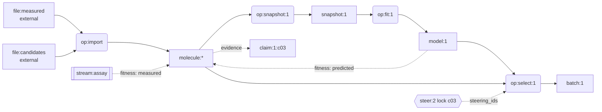

# The decision record in published vocabulary

Aster's decision record was built in its own shape: one JSON document per campaign
plus a short list of events. That shape answers "why did we test this, and were we
right?", but only Aster can read it. This document describes two exports that say the
same thing in vocabularies other people already use, so a campaign can be archived,
cited and read by tools that have never heard of Aster.

| Export | Command | What it follows |
| --- | --- | --- |
| Event log | `python -m aster.event_log --db campaign.sqlite events` | The seven record types of the Argonne observability profile |
| Invariant check | `python -m aster.event_log --db campaign.sqlite check` | The same profile's five invariants |
| Archive package | `python -m aster.event_log --db campaign.sqlite crate DIR [--license URL]` | RO-Crate 1.1, with W3C PROV-O provenance |

Neither export recomputes anything. Both read what the campaign stored at the time,
the same rule the [decision record](DECISION_RECORD.md) follows, so an export taken
today describes each decision as it was made.

## The event log

**Source.** Yin, Du, Prince and Cherukara, "Artifact-centered Claim-aware
Observability for Autonomous Scientific Agents", Advanced Photon Source, Argonne
National Laboratory, [arXiv:2608.18312](https://arxiv.org/abs/2608.18312) (2026).
Section 4 defines the abstractions; Appendix A, Table A.1 gives a "minimal event
contract" of seven record types, each with its minimum fields and one integrity rule.
It is a proposed profile, not a standard: there is no schema file and no validator, and
the paper says its own evaluation is planned rather than done.

**How Aster maps onto it.**

| Record type (Table A.1) | In an Aster campaign |
| --- | --- |
| Run and stream | The campaign is one run. Three streams emit into it: the selection code, the assay, and a person at the CLI or dashboard. |
| Individual | A compound, an input file (marked `external`), a training snapshot, a fitted model, a batch, a shadow batch, or a claim about a pick. |
| Operator | `import` (files to compounds), `snapshot` (measured compounds to a training set), `fit` (snapshot to model), `select` (model plus picked compounds to batch), `shadow_draw`. |
| Fitness record | A measurement, with the assay as evaluator; or one model's prediction for one compound, with that round's model as evaluator. A failed assay is a fitness record with verdict `failed`. |
| Archive event | A compound added to or removed from the `measured`, `locked` or `excluded` set. |
| Steering command | A lock, an exclusion, a release, or a person replacing the policy's picks before commit. |
| Evidence binding | One record cited by one claim: the measurement (`outcome`), the prediction (`prediction`), and the training snapshot that held the best value known then (`baseline`). |

A claim is the decision record's verdict on a pick, written as a sentence: "c03 beat
the best measurement known when it was picked". The paper lists "claim" among the
things an individual can be, so claims are individuals of kind `claim`, with status
`supported` when bound to evidence and `unsupported` when there is nothing to bind yet
(no result, or a failed assay).



**Two choices that matter.**

- *Append-only, literally.* Every reference in a row points at an earlier row, or at an
  individual marked `external`. A steering command does not get edited later to say
  what it affected; the `select` operator that it affected lists it under
  `steering_ids`. So any prefix of the log is itself a valid log, and the tests check
  that.
- *Context is not derivation.* Table A.1's operator rule says "context references do
  not imply derivation". The batch is derived from the model and the compounds picked;
  the rest of the eligible pool is listed under `context_ids`, not `parent_ids`.

**The five invariants**, quoted from Appendix A, and what `check` reports on a
campaign Aster wrote:

| # | Invariant | Result |
| --- | --- | --- |
| 1 | Every reference either resolves to an earlier event object or is marked as an external import | holds |
| 2 | Derivation edges are acyclic by artifact version | holds |
| 3 | Every final scientific claim has an evidence binding, a failed verification record, or an explicit unsupported status | holds |
| 4 | Evaluator outputs name the evaluator version and the individual they judged | holds, with a caveat below |
| 5 | Redaction removes payload access but not the fact that an event existed | does not apply: Aster never removes anything, so `holds` is `null`, not `true` |

The caveat on invariant 4: Aster has never recorded which *version* of an assay
protocol produced a measurement. The log names the closest thing it does have, the
SHA-256 of the file the measurement arrived in. That proves which file, not which
protocol. A real assay version would need a new field at import time.

## The archive package

**RO-Crate** (Research Object Crate, [w3id.org/ro/crate/1.1](https://w3id.org/ro/crate/1.1))
is a directory of files plus one `ro-crate-metadata.json` describing them in JSON-LD,
using schema.org terms. **W3C PROV-O** ([w3.org/TR/prov-o](https://www.w3.org/TR/prov-o/))
is the standard vocabulary for provenance: *entities* (things), *activities*
(processes that use and generate things) and *agents* (who is responsible).

The mapping into PROV is the one the Argonne paper states in section 4.2: individuals
to `prov:Entity`, operators to `prov:Activity`, streams to `prov:Agent`, and
parent-child edges to `prov:used` and `prov:wasGeneratedBy`. Each operator is also a
schema.org `CreateAction` with `object` (inputs) and `result` (outputs), which is how
RO-Crate itself describes a process.

The paper gives no PROV mapping for fitness records, evidence bindings, archive events
or steering commands, and warns that "the lossy boundary is claim semantics": those
should be kept "as explicit fields or companion files rather than compressed into free
text metadata". So they are not flattened into the metadata graph. They travel whole in
`events.jsonl`, which the metadata lists as a file of the crate with its hash.

A crate holds:

| File | Contents |
| --- | --- |
| `ro-crate-metadata.json` | The description and the PROV graph |
| `events.jsonl` | The event log, one record per line |
| `invariants.json` | The invariant report |
| `decision-record.json` | Every decision, as `python -m aster.decisions record` prints it |
| `campaign.json` | The campaign exactly as stored |

<a id="sha256"></a><a id="payloadHash"></a><a id="recordKind"></a>
Three terms are not in schema.org and are declared as RO-Crate "ad hoc" terms pointing
at this section: `sha256` (the hash of a file in the crate), `payloadHash` (the hash an
individual's content had in the event log) and `recordKind` (molecule, model, batch and
so on).

No licence is assumed. A crate meant for publication should be written with
`--license`, for example `https://creativecommons.org/licenses/by/4.0/`.

## How it was checked

On the public dashboard example (MoleculeACE CHEMBL238, 32 measured, 128 candidates),
replayed for four rounds of eight with the hidden outcomes reported back:

| Measure | Result |
| --- | --- |
| Events | 919: 4 run/stream, 210 individuals, 17 operators, 528 fitness records, 64 archive events, 96 evidence bindings |
| Claims | 32, all bound to evidence (1 beat the best value known, 31 did not) |
| Invariants 1 to 4 | all hold; 5 does not apply |
| PROV graph, read back as RDF | 178 entities, 17 activities, 3 agents; 250 `used`, 176 `wasGeneratedBy`; every `used` target is a typed entity |
| `ro-crate-py` 0.16.0 | loads the crate: 205 entities |
| `rocrate-validator` 0.14.0, profile ro-crate-1.1 | 25 of 26 requirements pass; the remaining one is the check that fetches the RO-Crate context from w3id.org, which the build machine's network refuses |

Reading the crate back as RDF caught one real bug before this shipped: an assay name
with a space made an invalid identifier, and the reader silently dropped that agent.
Identifiers are now percent-encoded, with the original id kept as `identifier`.

What was not checked: the validator's context-dependent checks never ran, because the
context could not be fetched. Run it on a machine with internet access:

```bash
pip install roc-validator
python -m aster.event_log --db campaign.sqlite crate my-crate
rocrate-validator validate -p ro-crate-1.1 my-crate
```

## Not done here

Queue item 12 also named the replay metrics of Mas et al., "Back to the future of lead
optimization: benchmarking compound prioritization strategies", *Digital Discovery*
2026, 5(7), 2983-2997, doi:10.1039/D5DD00387C. Their formulas could not be read from
the paper itself (the publisher refuses automated access), and implementing metrics
from a summary would be inventing them under someone else's name. That part is split
out as its own queue item.
